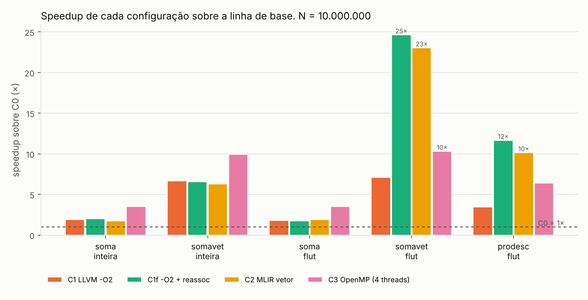
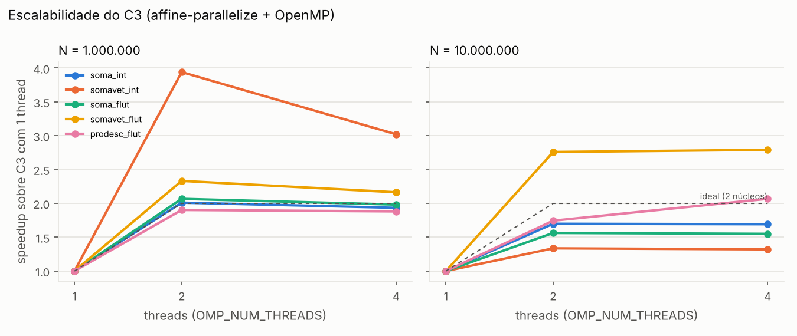

# Relatório de Otimização — PjBL 4, Partes B e C

Tudo neste relatório é reproduzível com **um comando**: `make bench`. Ele gera os núcleos a partir de um programa Macaronica (`scripts/bench/bench.mac.modelo`), rebaixa cada configuração, mede, e grava os resultados em `docs/resultados/`: tabela, gráficos, CSV, medições brutas, relatórios `-Rpass` e a IR final de cada configuração.

## Parte B — o mesmo núcleo em cada nível do pipeline

Núcleo: `c receba a + b;` com `inteira vet{1024}` (o mesmo do enunciado), mais a redução `somavet(c)`. Fonte em `docs/exemplos/nucleo1024.mac`. Os cinco níveis, salvos pelo próprio `pipeline.sh`, ficam em `docs/exemplos/niveis_base/` e `docs/exemplos/niveis_vetor/` (`1_affine` a `5_llvm`). Abaixo, o caminho com vetorização (modo `vetor`).

**Nível 1 — affine** (o que o compilador emite). O laço é um `affine.for` de 0 a 1024, e os acessos são `affine.load %a[%i]`. O dialeto affine **garante** que os limites e os índices são funções afins de `%i`, e é essa garantia que permite ao vetorizador provar que as iterações são independentes.

**Nível 2 — vector** (depois de `affine-super-vectorize`, `virtual-vector-size=8`):
```mlir
affine.for %arg3 = 0 to 1024 step 8 {
  %0 = vector.transfer_read %arg0[%arg3], %c0_i32 : memref<1024xi32>, vector<8xi32>
  %1 = vector.transfer_read %arg1[%arg3], %c0_i32 : memref<1024xi32>, vector<8xi32>
  %2 = arith.addi %0, %1 : vector<8xi32>
  vector.transfer_write %2, %arg2[%arg3] : vector<8xi32>, memref<1024xi32>
}
```
*Preservou:* a estrutura affine (passo 8) e a semântica. *Mudou:* o tipo do valor (`i32` → `vector<8xi32>`). A redução ganha um acumulador vetorial e uma redução horizontal só no fim:
```mlir
%0 = affine.for %arg1 = 0 to 1024 step 8 iter_args(%arg2 = %cst) -> (vector<8xi32>) { ... arith.addi %arg2, %2 : vector<8xi32> ... }
%1 = vector.reduction <add>, %0 : vector<8xi32> into i32
```
Isso **muda a ordem das somas**: são 8 somas parciais intercaladas, e não uma soma da esquerda para a direita. Para inteiros não importa (a soma em complemento de dois é associativa). Para `flut`, importa (ver a pergunta obrigatória, abaixo).

**Nível 3 — scf** (depois de `lower-affine` e `convert-vector-to-scf`): `affine.for` vira `scf.for %arg3 = %c0 to %c1024 step %c8`, com os limites como constantes `index` comuns. *Descartou:* a informação affine. Daqui em diante nenhum passo consegue mais provar facilmente que os índices são afins.

**Nível 4 — cf** (depois de `convert-scf-to-cf`): o laço estruturado vira blocos básicos (`^bb1` com `arith.cmpi slt` + `cf.cond_br`, `^bb2` com o corpo e `cf.br ^bb1`), a mesma forma do LLVM IR que o nosso PjBL 3 gera "à mão". *Descartou:* a noção de laço, que agora é só um ciclo no grafo de fluxo.

**Nível 5 — dialeto llvm** (depois de `convert-vector-to-llvm`, `finalize-memref-to-llvm`, `convert-func-to-llvm` etc.): `vector<8xi32>` vira `<8 x i32>` e cada `memref` vira um descritor (`{ptr, ptr, i64, [1 x i64], [1 x i64]}`). Com `use-bare-ptr-memref-call-conv=1`, a função recebe só um `ptr` por vetor e o descritor é montado dentro dela. Também aparece algo que **não** estava nos níveis anteriores:
```mlir
%42 = llvm.icmp "sgt" %41, %36 : vector<8xi32>      // mascara: quais das 8 posicoes estao dentro do vetor
```
Os `vector.transfer_read` foram rebaixados para leituras **com máscara**, porque o pipeline não marcou os acessos como `in_bounds`, embora 1024 seja múltiplo de 8 e nenhuma posição saia do vetor. É uma verificação redundante, que aparece na IR final do C2 como 64 ocorrências de `<8 x i1>` (`docs/resultados/tipos_vetoriais.txt`) e explica por que o C2 nunca ganha do C1 na soma elemento a elemento. Melhoria futura: emitir `vector.transfer_read ... {in_bounds = [true]}` quando N for múltiplo do tamanho do vetor.

**Nível 6 — LLVM IR** (`mlir-translate --mlir-to-llvmir`): sem `target triple`, como o resto do PjBL 3, pronto para o `llvm-link`.

**Discussão crítica.** O MLIR acertou o principal: a decisão de vetorizar foi tomada no nível affine, onde a independência das iterações é **óbvia**, e não no LLVM IR, onde o vetorizador precisa reconstruir laço, índices e ausência de aliasing a partir de `getelementptr`. O preço é que cada rebaixamento descarta informação (affine → scf → cf). Uma otimização esquecida num nível alto (o `in_bounds`) vira custo que nenhum passo seguinte recupera.

## Parte C — estudo experimental

### Máquina e método

`docs/resultados/maquina.txt`: **Intel Xeon, 2 núcleos** (sem hyper-threading), L1d 48 KiB e **L2 4 MiB por núcleo**, **AVX2 e AVX-512** (`avx512f/bw/vl`, `fma`), 7 GB de RAM, Linux 6.18 numa máquina virtual na nuvem, clang/LLVM/MLIR **18.1.3**.

| config | pipeline (`scripts/pipeline.sh`) | compilação da IR final |
|---|---|---|
| **C0** linha de base | `base` (sem vetorização) | `clang -O0` |
| **C1** otimização genérica | `base` | `clang -O2 -march=native` (o clang põe o triple do host: sem triple o LLVM não vetoriza, ver abaixo) |
| **C1f** C1 com reassociação | `base`, com `fastmath<reassoc>` em `arith.addf/mulf` | `clang -O2 -march=native` |
| **C2** vetorização explícita no MLIR | `vetor` (`affine-super-vectorize`, `virtual-vector-size=8`, `vectorize-reductions=true`) | `clang -O2 -march=native -fno-vectorize -fno-slp-vectorize` (vetorizador do LLVM **desligado**: só conta o do MLIR) |
| **C3** paralelismo | `paralelo` (`affine-parallelize max-nested=1 parallel-reductions=true` → `convert-scf-to-openmp` → `canonicalize`) | `clang -O2 -march=native -fopenmp`, `OMP_NUM_THREADS` = 1, 2, 4 |

- Núcleos: `soma` elemento a elemento (`inteira` e `flut`), `somavet` (`inteira` e `flut`) e `prodesc` (`flut`). Vetores de **10⁶ e 10⁷** elementos.
- Cada número é a **mediana de 5 processos**, e cada processo já reporta a mediana de 7 chamadas cronometradas (depois de 1 de aquecimento), com `clock_gettime(CLOCK_MONOTONIC)` (`scripts/bench/harness.c`).
- O **tempo de compilação** (pipeline + clang) é medido à parte, também como mediana de 5, na última linha de cada tabela.
- As medições brutas estão em `docs/resultados/bruto/`.

### Resultados

Gerados por `scripts/bench/graficos.py` (cópia de `docs/resultados/tabela.md`). Entre parênteses, o speedup sobre o C0.

**N = 1.000.000**

| núcleo | C0 | C1 | C1f | C2 | C3 (1 th) | C3 (2 th) | C3 (4 th) |
|---|---:|---:|---:|---:|---:|---:|---:|
| soma_int | 0.941 ms (1.0×) | 0.409 ms (2.3×) | 0.411 ms (2.3×) | 0.406 ms (2.3×) | 0.422 ms (2.2×) | 0.210 ms (4.5×) | 0.218 ms (4.3×) |
| somavet_int | 0.691 ms (1.0×) | 0.136 ms (5.1×) | 0.138 ms (5.0×) | 0.135 ms (5.1×) | 0.145 ms (4.8×) | 0.037 ms (18.8×) | 0.048 ms (14.4×) |
| soma_flut | 0.933 ms (1.0×) | 0.412 ms (2.3×) | 0.420 ms (2.2×) | 0.404 ms (2.3×) | 0.434 ms (2.1×) | 0.210 ms (4.4×) | 0.219 ms (4.3×) |
| somavet_flut | 4.143 ms (1.0×) | 0.526 ms (7.9×) | 0.135 ms (30.6×) | 0.137 ms (30.4×) | 0.624 ms (6.6×) | 0.268 ms (15.5×) | 0.288 ms (14.4×) |
| prodesc_flut | 3.902 ms (1.0×) | 0.599 ms (6.5×) | 0.283 ms (13.8×) | 0.271 ms (14.4×) | 0.650 ms (6.0×) | 0.341 ms (11.4×) | 0.345 ms (11.3×) |
| *compilação* | 86 ms | 105 ms | 112 ms | 150 ms | 160 ms | 160 ms | 160 ms |

**N = 10.000.000**

| núcleo | C0 | C1 | C1f | C2 | C3 (1 th) | C3 (2 th) | C3 (4 th) |
|---|---:|---:|---:|---:|---:|---:|---:|
| soma_int | 11.220 ms (1.0×) | 5.958 ms (1.9×) | 5.521 ms (2.0×) | 6.441 ms (1.7×) | 5.385 ms (2.1×) | 3.170 ms (3.5×) | 3.183 ms (3.5×) |
| somavet_int | 11.251 ms (1.0×) | 1.682 ms (6.7×) | 1.717 ms (6.6×) | 1.795 ms (6.3×) | 1.499 ms (7.5×) | 1.122 ms (10.0×) | 1.135 ms (9.9×) |
| soma_flut | 11.213 ms (1.0×) | 6.278 ms (1.8×) | 6.329 ms (1.8×) | 5.819 ms (1.9×) | 4.966 ms (2.3×) | 3.177 ms (3.5×) | 3.203 ms (3.5×) |
| somavet_flut | 40.916 ms (1.0×) | 5.774 ms (7.1×) | 1.661 ms (24.6×) | 1.776 ms (23.0×) | 11.070 ms (3.7×) | 4.012 ms (10.2×) | 3.966 ms (10.3×) |
| prodesc_flut | 38.838 ms (1.0×) | 11.294 ms (3.4×) | 3.333 ms (11.7×) | 3.830 ms (10.1×) | 12.505 ms (3.1×) | 7.169 ms (5.4×) | 6.048 ms (6.4×) |
| *compilação* | 85 ms | 104 ms | 114 ms | 144 ms | 159 ms | 159 ms | 159 ms |





### Conclusões, cada uma com a sua evidência

**1. Sem target triple, o LLVM não vetoriza nada.** O IR que sai do `mlir-translate` (e o do PjBL 3) não tem triple. `opt -O2` aplicado a ele não produz **nenhum** tipo vetorial; com `-mtriple=x86_64-pc-linux-gnu -mcpu=native`, aparecem 81 `<8 x i32>` e 32 `<8 x float>` (`docs/resultados/tipos_vetoriais.txt`, e as IR em `ir_opt_O2_sem_triple.ll` / `ir_opt_O2_com_triple.ll`). Sem triple, o modelo de custo não sabe a largura dos registradores e supõe que não existe SIMD. Por isso o C1 usa `clang -march=native`, que põe o triple do host.

**2. O C1 autovetorizou 3 dos 5 laços.** `docs/resultados/rpass_C1.txt` traz três `vectorized loop (vectorization width: 8, interleaved count: 4)` (as duas somas elemento a elemento e a redução inteira) e duas vezes `loop not vectorized: cannot prove it is safe to reorder floating-point operations` (as duas reduções `flut`). Com `fastmath<reassoc>` (C1f), os cinco são vetorizados (`rpass_C1f.txt`), e a IR final passa de 32 para 153 `<8 x float>`. O LLVM escolheu 8 lanes de 32 bits (256 bits) mesmo com AVX-512 disponível. Nossa hipótese, não verificada, é a preferência padrão do LLVM por vetores de 256 bits em processadores com AVX-512 (`prefer-vector-width`), que evita a queda de frequência das instruções de 512 bits. O atributo não aparece na IR final; testar `-mprefer-vector-width=512` seria o próximo experimento.

**3. A soma elemento a elemento é limitada pela memória, não pela conta.** O C1, o C1f e o C2 ficam todos em ~2,3× (10⁶) e ~1,8× (10⁷), seja qual for o vetorizador. Cada elemento faz 1 soma, mas move 12 bytes (2 leituras, 1 escrita), e a 10⁷ (120 MB) tudo vem da RAM. Vetorizar mais não adianta. Só o C3 passa disso, porque 2 núcleos usam mais banda de memória que 1.

**4. As reduções são limitadas pela latência, e por isso ganham muito mais.** No C0, cada soma da redução depende da anterior (uma cadeia de dependência), e o processador espera a latência do `fadd` a cada elemento. Vetorizar com `interleaved count: 4` cria 32 acumuladores independentes (8 lanes × 4), o que quebra a cadeia: `somavet_flut` vai de 4,1 ms para 0,135 ms (**30×** em 10⁶). A redução inteira ganha menos (5×) porque o `add` inteiro tem latência de 1 ciclo; o `fadd`, de 4.

**5. C2 vs C1: o vetorizador do MLIR fez o que o do LLVM não fez.** Com o vetorizador do LLVM **desligado**, o C2 vetorizou as reduções `flut` **sem nenhuma permissão de reassociação** (30,4× em 10⁶, igual ao C1f), enquanto o C1 se recusou. O `affine-super-vectorize` com `vectorize-reductions=true` reordena a soma sem perguntar, e isso **mudou o resultado numérico** (próxima seção). No sentido contrário, o LLVM fez melhor nos laços simples: o C2 carrega as máscaras redundantes da Parte B, por isso nunca ganha do C1 na soma elemento a elemento. O C2 também compila mais devagar (150 contra 105 ms), porque o pipeline tem mais passos.

**6. C3: perto de 2× com 2 threads, e nada a mais com 4.** A máquina tem 2 núcleos físicos. Com 4 threads há sobreassinatura, e o speedup cai um pouco (troca de contexto). Em 10⁶, as somas elemento a elemento chegam a 1,97× (de 0,422 para 0,210 ms), quase o ideal.

**Resultado inesperado 1: speedup acima do ideal.** Em 10⁶, `somavet_int` vai de 0,145 ms (1 thread) para 0,037 ms (2 threads), **3,9×** com 2 núcleos. A explicação é a cache. Cada núcleo tem **4 MiB de L2 privada** (`lscpu`), e o vetor de 10⁶ `inteira` ocupa exatamente 4 MB, ou seja, não cabe inteiro na L2 de um núcleo junto com o resto. Com 2 threads, cada uma lê 2 MB, que cabem na sua L2: as repetições cronometradas passam a ler da L2 em vez da L3. Duas evidências apoiam isso: (a) o efeito só aparece nas **reduções**, que leem um vetor só, e não nas somas elemento a elemento, que movem 12 MB e não cabem em nenhum caso; (b) em 10⁷ (40 MB por vetor, que não cabe em L2 nenhuma) o efeito some, e `somavet_int` fica em 1,3×.

**Resultado inesperado 2: o C3 com 1 thread é mais lento que o C1 nas reduções `flut`** (11,1 ms contra 5,8 ms em 10⁷). O C3 é compilado sem `reassoc`, então a redução `flut` de cada thread não é vetorizada. Além disso, o laço passa pelo runtime do OpenMP mesmo com 1 thread. O paralelismo do C3 também reassocia a soma (cada thread soma uma metade), mas isso não dá permissão ao vetorizador do LLVM dentro de cada thread.

**Resultado inesperado 3: defeito do MLIR 18 no `affine-parallelize`.** Com `parallel-reductions=true`, uma redução de **máximo inteiro** (`arith.maxsi`) produz um `affine.parallel` inválido (`'affine.parallel' op result type cannot match reduction attribute`). Isolamos o caso: `arith.addi` e `arith.maximumf` funcionam, só o `arith.maxsi` falha. O `pipeline.sh` contorna isso paralelizando cada núcleo separadamente e refazendo só o que falha com `parallel-reductions=false` (a redução fica sequencial, com um aviso). O `make test` roda os testes da DSL nesse modo e confirma que o resultado continua correto (`tests/dsl/03_reducoes.mac`).

**Ruído das medições em 10⁷.** Em 10⁶, as 5 execuções de cada medição variam menos de 2%. Em 10⁷ (120 MB, sempre indo à RAM, numa máquina virtual compartilhada), aparecem execuções isoladas até 2,6× mais lentas (`docs/resultados/bruto/10000000_exec_C3_2_3.txt`: `soma_int` levou 8,39 ms, contra ~3,2 ms nas outras quatro). A mediana descarta esses casos, mas as diferenças de menos de ~15% entre configurações em 10⁷ não devem ser lidas como reais. Numa segunda rodada, a mesma configuração C1 deu 7,3 ms para `prodesc_flut`, contra 11,3 ms nesta.

### Pergunta obrigatória: por que a redução de ponto flutuante não é vetorizada sem `-ffast-math`, e a inteira é?

**Porque vetorizar uma redução muda a ordem das somas, e a soma de ponto flutuante não é associativa.**

A redução sequencial calcula `((((0 + a0) + a1) + a2) + a3) + ...`. A versão vetorizada calcula 8 somas parciais intercaladas (`a0 + a8 + a16 + ...`, `a1 + a9 + ...`), 32 com interleave 4, e junta tudo no final. Para inteiros em complemento de dois, `(x + y) + z == x + (y + z)` **sempre**, inclusive com estouro (a aritmética é módulo 2³²), então qualquer ordem dá o mesmo resultado bit a bit, e o vetorizador pode reordenar livremente. Para `float`, cada soma arredonda o resultado para 24 bits de mantissa. Somar em outra ordem arredonda em outros pontos e, em geral, dá **outro número**. O LLVM só pode fazer uma transformação que preserva o resultado, a menos que o programador dê permissão para reassociar. Essa permissão é a flag `reassoc` na instrução (o que `-ffast-math` liga, entre outras coisas). Por isso o `-Rpass` do C1 diz exatamente `cannot prove it is safe to reorder floating-point operations`.

**Verificação experimental em Macaronica (`flut`, N = 10⁷):**

| configuração | `somavet_flut` | `prodesc_flut` |
|---|---:|---:|
| C0 sequencial (`-O0`) | 48579936.0 | 12023276.0 |
| C1 `-O2`, sem permissão: **não vetorizou** | 48579936.0 | 12023276.0 |
| C1f `-O2` + `fastmath<reassoc>`: vetorizou | 49500000.0 | 12108604.0 |
| C2 vetorizador do MLIR (reordena sem pedir) | 49500000.0 | 12107222.0 |
| C3 OpenMP, 2 threads | 49338936.0 | 12104357.0 |

1. Todas as configurações que **não** reordenam (C0 e C1) dão o mesmo resultado, bit a bit. Todas as que reordenam dão resultados **diferentes entre si**: o produto escalar tem quatro valores distintos para a mesma conta.
2. O valor exato de `somavet_flut` é **49.500.000** (cada bloco de 100 elementos soma 0,1 × 4950 = 495, e há 10⁵ blocos). A soma sequencial erra **1,9%**: quando o acumulador passa de 2²⁴ ≈ 16,7 milhões, cada parcela pequena perde quase todos os bits ao ser somada. As versões vetorizadas acertam o valor exato, porque cada um dos 32 acumuladores fica pequeno. Ou seja, a reordenação não é "menos correta"; ela é **diferente**, e aqui até mais precisa. O compilador não tem como saber disso, e por isso só reordena com permissão.
3. A redução inteira (`somavet_int`) dá o mesmo valor em todas as configurações (`docs/resultados/bench.csv`) e é vetorizada pelo C1 sem nenhuma flag (`rpass_C1.txt`). Em 10⁷, esse valor é 700032704, e não a soma real de 4.995.000.000: a soma passou de 2³¹ e **deu a volta**, como define a política de estouro do PjBL 3 (`decisoes_backend.md` 1.6). Mesmo dando a volta, todas as ordens de soma chegam ao mesmo número, porque a soma módulo 2³² é associativa.

**Detalhe de implementação.** `clang -ffast-math` aplicado a um arquivo `.ll` pronto **não muda nada**: na primeira rodada, o C1f com essa flag teve os mesmos tipos vetoriais e os mesmos resultados do C1. A flag age no front-end C, que marca as instruções que ele mesmo gera; num `.ll`, as instruções já existem sem a marca. O equivalente no nosso pipeline é marcar as operações no MLIR: `REASSOC=1 scripts/pipeline.sh` troca `arith.addf %a, %b : f32` por `arith.addf %a, %b fastmath<reassoc> : f32`, e o `mlir-translate` gera `fadd reassoc float`.
